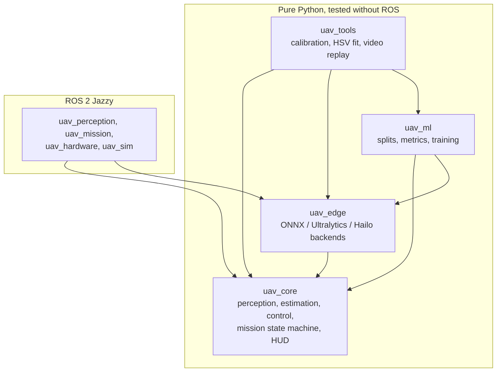
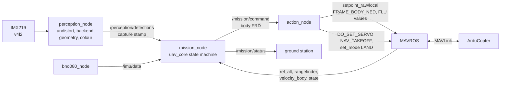

# Architecture

## Layers

Dependencies point one way and import-linter enforces it in CI: `uav_core` imports nothing
from the repo, nor ROS, torch, ultralytics or onnxruntime; `uav_edge` and `uav_ml` never
import the operator tools; nothing imports `legacy/`. Each ROS node is a thin shell whose
logic lives in a ROS-free module (`bridge.py`, `setpoint.py`, `pipeline.py`, `referee.py`)
that the main test suite covers.

## Runtime graph (real drone)

- **Frames never cross DDS** on the drone: `perception_node` reads the camera itself and
  publishes only detections (a few hundred bytes).
- **Time comes from the capture stamp.** `mission_node` uses the detections' header stamp as
  its clock and synchronises the IMU to it, so the same code runs on sim time.
- **Every convention change happens in `uav_core.frames`** (ADR-0003): commands are body FRD
  inside the stack and FLU on the MAVROS side; the IMU and body velocity come in as FLU/ENU
  and are converted on entry.
- **Safety gates:** `action_node` sends nothing (and never drops a ball) unless the FC is in
  GUIDED; `mission_node` publishes a hover command when detections stop for 0.5 s, and
  `/mission/e_stop` latches a hover until `/mission/reset`.

## Per-frame data flow

| Step | Where | Notes |
|---|---|---|
| Capture | `perception_node` | v4l2 on the Pi, bridged Gazebo image in simulation |
| Undistort | `uav_core.perception.camera.Undistorter` | maps computed once; `f_px` of the undistorted image |
| Inference | `uav_edge` backend | Hailo-8L INT8 on the Pi, ONNX on a CPU |
| Decode | `uav_edge.runtime.heads` / `yolo_seg` | numpy: DFL, NMS, prototype masks at 1/4 scale, letterbox crop |
| Geometry, colour, filters | `uav_core.perception` | contours on the small mask (ADR-0005), HSV ranges from `config/hsv_calib.json` |
| Mission step | `uav_core.mission.MissionStateMachine.step` | altitude priority FC > ToF > vision (ADR-0004), timers in seconds (ADR-0001) |
| Command | `action_node` | FRD -> FLU, one PositionTarget per step |

## Timing budget

Target: at least 20 Hz end to end (50 ms per frame).

| Stage | Measured so far | Where it runs on the drone |
|---|---|---|
| Preprocess, decode, geometry, colour, mission step | 1.6-2.5 ms on a Mac CPU (`edge/benchmarks`) | Pi 5 CPU |
| Inference | 70 ms (YOLO11s @ 416) on a Mac CPU | Hailo-8L NPU: to be measured in M4 |
| Camera latency compensation | `estimation.camera_latency_s` = 70 ms default | only when a frame has no stamp |

The CPU side is small enough that the NPU decides whether 20 Hz holds.

## Configuration

One validated, immutable `MissionConfig` (pydantic), loaded once at the boundary and passed to
constructors; invalid values stop the program at startup (ADR-0002). The reference of every
key is generated: [config-reference.md](config-reference.md).
