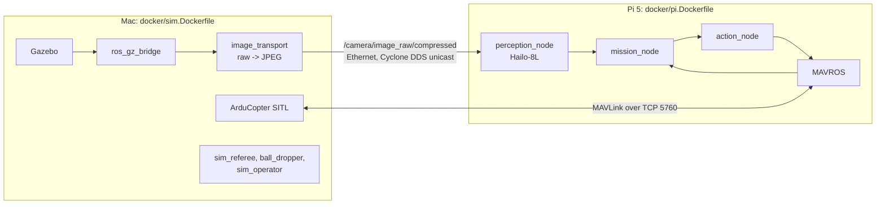

# Hardware-in-the-loop (M5)

The Mac simulates the world and the autopilot; the Pi 5 runs the real flight stack with
perception on the Hailo-8L, exactly the split of real flight (where the Pi talks MAVLink to
the FC). Not run yet: it needs the Pi, the Hailo-8L and a compiled `.hef`.



## Setup

1. A direct Ethernet cable; static addresses, e.g. Mac `10.0.0.1`, Pi `10.0.0.2`.
2. Both sides: `RMW_IMPLEMENTATION=rmw_cyclonedds_cpp`,
   `CYCLONEDDS_URI=file:///etc/cyclonedds.xml` (`docker/cyclonedds.xml`), with `IFACE` set
   to the cable's interface and `PEER_IP` to the other machine.
3. Mac:

   ```bash
   docker compose -f docker/compose.yaml run --rm --network host sim \
       ros2 launch uav_bringup sim.launch.py weights:=unused part:=sim seed:=0
   ```

4. Pi:

   ```bash
   docker run --rm --network host --device /dev/hailo0 -v /opt/uav:/models uav-pi \
       ros2 launch uav_bringup sim.launch.py weights:=/models/best.hef part:=stack \
       fcu_url:=tcp://10.0.0.1:5760 seed:=0
   ```

Both sides generate the same scenario from the seed (the Pi needs the simulated camera's
calibration).

## What it measures

- **Closed-loop latency**: capture stamp (Gazebo) to `PositionTarget` (Pi), from the
  `/perception/detections` and `/mission/command` stamps.
- **Image transport separately**: JPEG encode on the Mac, transfer, decode on the Pi. This
  cost does not exist on the real drone (the camera is local), so it is reported apart from
  perception latency.
- Success rate and failure taxonomy over N >= 10 runs (`scripts/run_monte_carlo.sh`
  adapted to start the two halves), compared with the pure-simulation Monte Carlo.

HailoRT in the container must match the PCIe driver on the host exactly; put the matching
wheel in `docker/wheels/` before building `docker/pi.Dockerfile`.
