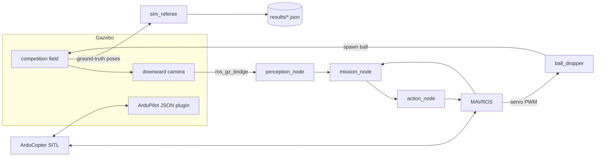

# Closed-loop simulation

Gazebo Harmonic renders the competition field and the drone's downward camera; ArduCopter
SITL flies the drone; MAVROS connects it to the same ROS 2 nodes that run on the Pi. Only the
camera source differs: `perception_node` reads the bridged Gazebo image instead of v4l2.



## Running it

```bash
scripts/fetch_assets.sh yolo11s-seg_synth_export-2026-04-24.onnx
docker compose -f docker/compose.yaml build sim          # 7-9 GB, builds SITL from source
SEED=7 docker compose -f docker/compose.yaml run --rm sim
docker compose -f docker/compose.yaml run --rm sim ros2 launch uav_bringup sim.launch.py \
    weights:=/assets/yolo11s-seg_synth_export-2026-04-24.onnx mode:=direction_check \
    results_dir:=/results
```

`.github/workflows/sim-smoke.yml` runs the world validation, the direction check and one
qualifier match headless on every change to the simulation or the stack.

## Scenarios

`make_scenario(seed, round)` (`uav_sim/scenario.py`) fixes everything random in one seed:

| Drawn from the seed | Range |
|---|---|
| Target positions | Qualifier: figure 1 of the rulebook. Semi-final and final: uniform over the fire area, 1 m apart edge to edge and from the gates (the organisers' position matrix is not published) |
| Sun azimuth / elevation / intensity | 0-360 deg / 35-85 deg / 0.6-1.2 |
| Court floor | dark grey, slightly tinted |
| Wind (`SIM_WIND_SPD/DIR/TURB`) | 0-3 m/s, any direction, turbulence 0-0.5 |
| Sensor noise (`SIM_BARO_RND`, `SIM_GYR_RND`, `SIM_ACC_RND`) | small |

In the final, `target_mover` moves F2 back and forth along x at 0.1 m/s over +/-2.5 m.

The simulated camera is 640x480 with a 1.8 rad horizontal field of view and Brown distortion
(k1 = -0.25, k2 = 0.08); `make_world` writes the matching `sim_calibration.npz`, so the
undistortion path runs in simulation too.

## The referee

`sim_referee` never reads the mission's self-reported score. It uses ground-truth poses from
Gazebo and applies the rulebook (27/02/2026) with these interpretations:

| Rule | How it is judged |
|---|---|
| Automatic takeoff (§V) | The drone first reaches 3.0 m |
| Ball in a target (§V, §VII-2) | The ball comes to rest inside the target's circle; each target scores once; a second ball in a done target scores nothing |
| Altitude below 3.0 m (§VII-1) | 5 points per full 5 s below 3.0 m, from the first time the drone reaches 3.0 m until it is above the helipad area (+1 m) for landing |
| Leaving the field (§VII-1) | 5 points per full 5 s outside the 24 x 12 m rectangle |
| Touching a TZ gate (§VII-1) | 5 points per contact episode, judged geometrically (drone sphere of 0.3 m against the ring and post) |
| Automatic landing (§VI) | Touchdown with the whole drone inside the 1.5 m helipad |
| Match time | 300 s from arming; a touchdown ends the match |

Each run writes `results/<round>-<seed>.json` with the score breakdown, every event and a
failure taxonomy (`no_takeoff`, `targets_missed`, `missed_drop`, `altitude_penalty`,
`out_of_bounds`, `gate_contact`, `timeout`, `landed_outside_helipad`).

## What the simulation found before it ran

Writing the bridge for SITL exposed two integration gaps that would also have hit the real
drone: ArduCopter ignores GUIDED velocity setpoints while landed (`action_node` now sends
`MAV_CMD_NAV_TAKEOFF` once), and a GUIDED velocity descent sits on the pad with motors
running (`action_node` switches to LAND once the mission says LAND over the helipad).
